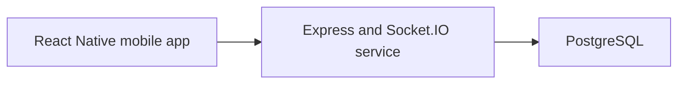

# Team Collaboration App

## Architecture

A mobile project for small teams to coordinate events and room conversations.

### Follow one interaction

Create a room and invite another member. Messages are delivered over a live socket connection; a separate HTTP request retrieves saved information when a member opens the app again.

## APIs and interfaces

| Connection | What crosses it |
| --- | --- |
| Mobile → REST API | The React Native client uses the Express API for sign-up, login and saved room data. Its session is kept with Expo SecureStore. |
| Mobile → room socket | Socket.IO carries live chat events; the server uses PostgreSQL for records that need to survive a disconnect. |

### Why it works this way

The mobile app keeps its session in device secure storage. Live notifications and the database have different jobs, so a temporary disconnect need not define the state of a room.

## Source in this repository

Read [api.js](api.js) to see how the mobile client attaches its local session when calling the team API. This is an excerpt from the original app.

[Back to the project index](https://github.com/IT-Yun/IT-Yun)
